<div align="center">

# Detective AI

### Локальная AI-доска для исследования открытых источников

**Карточки объектов · проверяемые связи · документы · вопросы · история каждого запуска**


</div>

> Detective AI помогает собирать материалы дела в единый граф. Пользователь управляет объектами и гипотезами, а локальный Codex CLI ищет проверяемые сведения, заполняет реквизиты и предлагает связи с обязательным указанием источников.

Все объекты демонстрационного дела вымышлены. Проект предназначен для законной работы с открытыми источниками, а не для слежки, доксинга или автоматического вынесения обвинений.

## Что умеет приложение

| Область | Возможности |
|---|---|
| **Доска** | Люди, компании, документы, события, места, заметки и вопросы; перетаскивание, масштабирование, радиальная и древовидная раскладка; динамическое крепление линий к ближайшей грани карточки |
| **Исследование объекта** | Заполнение реквизитов, поиск новых подтверждаемых сведений и продолжение с предыдущей контрольной точки |
| **Поиск связи** | Исследование отношений между двумя и более выбранными карточками с поддержкой промежуточных объектов |
| **Материалы** | PDF, Word, Excel, Markdown, CSV, JSON, HTML, XML, YAML, логи и обычные текстовые файлы до 24 МБ |
| **Вопросы** | Отдельные карточки с критерием ответа, ручным ответом, доисследованием и преобразованием результата в сущности и связи |
| **История** | Исходный запрос, время, результат, ошибка или явный пустой ответ, перечень созданных карточек и изменений |
| **Источники** | URL, дата публикации, дата проверки, свежесть источника, уверенность и объяснение связи |
| **Инспектор** | Сворачиваемые разделы карточек и связей, индивидуальное запоминание состояния, команды раскрытия и сворачивания всех разделов |
| **Интеграции** | Codex CLI, проектные MCP-серверы и импорт Google Контактов в режиме только для чтения |
| **Дела** | Отдельные локальные дела вида `Дело № 0001 — Иван Морозов`, импорт и экспорт `.detective`/JSON |

### Основной сценарий

```text
Создать дело
    ↓
Добавить карточки, заметки и документы
    ↓
Запустить «Найти информацию» для выбранных объектов
    ↓
Проверить источники и новые реквизиты
    ↓
Выделить 2+ карточки и запустить «Найти связь»
    ↓
Разобрать вопросы, изменения и историю исследования
```

Исследования выполняются потоково: карточка показывает текущий этап, новые элементы появляются на доске в реальном времени, а завершение фиксируется в центре обновлений даже тогда, когда ничего нового не найдено.

## Быстрый старт

### Требования

- Node.js 22 или новее;
- npm;
- Codex CLI — только для AI-исследований;
- авторизация Codex через `codex login`.

### Разработка

```bash
git clone <адрес-репозитория>
cd detective-ai
npm install
cp .env.example .env
npm run dev
```

Откройте [http://localhost:5173](http://localhost:5173). Vite автоматически перенаправляет API-запросы на локальный сервер по адресу `http://localhost:8787`.

Если проект уже находится на компьютере:

```bash
cd detective-ai
npm install
npm run dev
```

### Production-режим

```bash
npm run build
npm start
```

После сборки интерфейс и API доступны на [http://localhost:8787](http://localhost:8787).

## Конфигурация

Все параметры необязательны. Без Codex приложение остаётся полноценной ручной доской.

```dotenv
# Явный путь нужен только тогда, когда codex отсутствует в PATH.
CODEX_CLI_PATH=

PORT=8787
HOST=127.0.0.1

# Необязательная замена встроенного публичного Desktop OAuth Client ID.
GOOGLE_CLIENT_ID=
GOOGLE_REDIRECT_URI=http://127.0.0.1:8787/api/google/oauth/callback
```

### Codex CLI

При запуске сервер автоматически проверяет наличие команды, версию и состояние авторизации. Если CLI находится в нестандартном месте, укажите абсолютный путь в `CODEX_CLI_PATH`.

```bash
codex login
npm run dev
```

Приложение передаёт Codex контекст конкретного дела через `stdin`, принимает поток JSONL-событий и валидирует финальный результат по JSON Schema до изменения графа. Дополнительный валидатор проверяет существование карточек и источников, запрещает подтверждаемую линию без доказательства и не принимает непроверяемый граф.

### MCP-серверы

MCP настраиваются на отдельном экране приложения. Конфигурация применяется только к конкретному запуску `codex exec`; глобальный файл `~/.codex/config.toml` не изменяется. В веб-режиме Web Search и каждый включённый MCP являются обязательными каналами: приложение проверяет реальные JSONL-события вызовов и не помечает исследование завершённым, если хотя бы один канал не был успешно опрошен. Поскольку headless-режим не может показать диалог подтверждения MCP, включённые серверы автоматически подтверждаются только внутри этого запуска — включать следует лишь доверенные read-only серверы.

Секреты не сохраняются в настройках дела. В интерфейсе указывается только имя переменной окружения:

```bash
export BRAVE_API_KEY='...'
npm run dev
```

### Google Контакты

Интеграция использует Google People API, публичный OAuth-клиент типа **Desktop app**, PKCE и минимальный scope `contacts.readonly`. Пользователю не нужны собственные ключи: достаточно открыть настройки и нажать **Подключить Google**. Авторизация выполняется в отдельном окне Google и не передаёт пароль приложению.

В macOS refresh token хранится в системной Связке ключей. На остальных поддерживаемых системах используется локальный файл `data/google-contacts-token.json` с правами `0600`, исключённый из Git. Старый локальный токен на macOS автоматически переносится в Связку ключей. `GOOGLE_CLIENT_ID` в `.env` нужен только разработчику для замены встроенного публичного клиента. Если конкретная регистрация Google требует `GOOGLE_CLIENT_SECRET`, он задаётся только в локальном `.env`, никогда не включается в исходный код и не отправляется в Git. Импорт контакта не запускает исследование автоматически.

## Работа с доской

- один клик выбирает карточку;
- двойной клик или `Enter` открывает инспектор;
- `Shift`, `Ctrl` или `Cmd` добавляют карточки к выделению;
- правая кнопка открывает контекстные действия;
- двойной клик по пустой области открывает форму новой карточки;
- соединитель на карточке создаёт ручную связь;
- правая кнопка по пустой области добавляет объект, контакт или материал;
- при выделении одной карточки раскладка строит вокруг неё «солнышко»;
- без выделения раскладка упорядочивает весь граф по связанным компонентам.

Команда **Найти информацию** обрабатывает только новые или изменённые материалы, а затем по желанию продолжает поиск в открытых источниках. Команда **Найти связь** появляется для двух и более выбранных карточек.

## Архитектура

```text
detective-ai/
├── src/
│   ├── client/                 React-интерфейс и управление графом
│   │   ├── components/         доска, инспектор, диалоги и настройки
│   │   ├── lib/                слияние результатов, раскладка и импорт
│   │   ├── motion/             уровни и правила анимации
│   │   └── ui/                 базовые контролы и модель выделения
│   ├── server/                 Express API и запуск исследований
│   │   ├── codex/              обнаружение CLI и авторизации
│   │   ├── google/             OAuth и адаптер Google People API
│   │   ├── research/           документы, промпты, поток и JSON Schema
│   │   └── storage/            дела, материалы и MCP-настройки
│   └── shared/                 доменная модель и общие правила
├── tests/                      Vitest-тесты поведения
├── .agents/skills/             проектный навык detective-osint
├── data/                       локальные пользовательские данные
└── README.md
```

### Поток исследования

```mermaid
flowchart LR
    UI[Карточка на доске] --> API[Express API]
    API --> Context[Контекст дела + журнал]
    Context --> Codex[Codex CLI + обязательные MCP]
    Codex --> Audit[Аудит запросов и покрытия]
    Audit --> Schema[JSON Schema + доказательность]
    Schema --> Merge[Дедупликация и слияние]
    Merge --> Store[Локальное дело]
    Store --> Board[Карточки, связи и уведомления]
```



Ключевые точки расширения:

- новый тип объекта — `src/shared/domain.ts` и `src/shared/entityAttributeCatalog.ts`;
- правила визуального статуса связи — `src/shared/evidenceStyle.ts`;
- новый источник или режим исследования — `src/server/research/`;
- новый адаптер хранения — `src/server/storage/`;
- UI-компоненты — `src/client/components/`;
- правила OSINT-агента — `.agents/skills/detective-osint/`.

## Данные и доказательность

Дела, материалы, настройки и OAuth-токены хранятся локально в `data/` и не должны попадать в Git. Файлы материалов дедуплицируются по SHA-256.

Локальный сервер по умолчанию слушает только `127.0.0.1`. API принимает запросы только с loopback-адресов, отклоняет внешние браузерные Origin/Host и добавляет защитные HTTP-заголовки. Приложение не рассчитано на прямую публикацию порта `8787` в интернет: для многопользовательского режима потребуются отдельные аутентификация, авторизация и изоляция данных.

AI не управляет стилем линий напрямую. Он возвращает структурированный статус, а приложение выбирает визуальное представление:

| Статус | Значение |
|---|---|
| `official` | первичный официальный источник |
| `corroborated` | несколько независимых надёжных источников |
| `probable` | подтверждение неполное |
| `hypothesis` | направление для дальнейшей проверки |
| `user_asserted` | утверждение добавлено пользователем |
| `contradicted` | источники противоречат друг другу |
| `unknown` | данных недостаточно |

Повторный запуск получает уже накопленный контекст и проверенные URL. Сущности, источники и линии сопоставляются по содержанию: дубликаты не создаются, а новые подтверждения обновляют существующие элементы. Для каждого запуска сохраняются исходный вопрос, фактические поисковые запросы, обращения к MCP, использованные URL, покрытие обязательных каналов, время, изменения и явный пустой ответ. Этот журнал доступен в истории исследования карточки.

## Материалы

Поддерживаются PDF, `.docx`, `.xlsx`/`.xlsm`, Markdown, TXT, CSV/TSV, JSON/JSONL, XML, HTML, YAML, логи и распознанные текстовые файлы размером до 24 МБ.

- старые бинарные `.doc` и `.xls` нужно предварительно преобразовать;
- PDF-сканам без текстового слоя требуется OCR;
- очень длинный текст ограничивается первыми 180 000 символами;
- уже обработанная редакция файла повторно не анализируется;
- номера телефонов, email, ИНН, ОГРН, КПП и другие реквизиты из файла могут быть извлечены и сопоставлены; источником такого значения остаётся сам файл;
- изменённый файл получает новую редакцию и снова попадает в очередь.

## Проверка проекта

Пошаговая ручная приёмка всех экранов, кнопок, контекстных действий, интеграций и ошибочных сценариев описана в [программе и методике испытаний](./docs/TEST_PROGRAM.md).

```bash
npm run typecheck   # клиент и сервер
npm test            # поведенческие тесты
npm run build       # production-сборка
```

Полная локальная проверка одной командой:

```bash
npm run verify
```

`verify` проверяет секреты в отслеживаемых файлах, зависимости, SemVer, типы, тесты и production-сборку. Полная проверка Git-истории выполняется командой:

```bash
npm run security:secrets -- --history
```

## Работа через GitHub и версии

Проект использует [Semantic Versioning](https://semver.org/): `MAJOR.MINOR.PATCH`. Текущая версия хранится одновременно в `package.json` и `package-lock.json`; их согласованность проверяет CI.

```bash
git switch main
git pull --ff-only
npm ci
npm run verify
npm version patch   # либо minor / major
git push origin main --follow-tags
```

Перед первым push создайте пустой GitHub-репозиторий без автоматически добавленных README, `.gitignore` и лицензии, затем добавьте его как `origin`. Подробная процедура находится в [руководстве по публикации](./docs/RELEASING.md). Правила изменений описаны в [CONTRIBUTING](./.github/CONTRIBUTING.md), история версий — в [CHANGELOG](./CHANGELOG.md), сообщения об уязвимостях — в [SECURITY](./.github/SECURITY.md).

Пользовательские дела, документы, `.env`, OAuth-токены и MCP-настройки никогда не должны попадать в commit, issue, pull request или GitHub Release. Экспорт `.detective` также считается пользовательскими данными.

Лицензия пока не выбрана. До её явного добавления публикация исходного кода не предоставляет третьим лицам автоматического разрешения копировать, изменять или распространять проект.

## Технологии

- React 19 и TypeScript;
- XYFlow для графа;
- Express 5 для локального API;
- Zod и JSON Schema для проверки данных;
- Vitest для тестов;
- `pdf-parse`, `mammoth` и `exceljs` для документов;
- собственная визуальная система Detective UI.

---

<div align="center">

**Detective AI сохраняет решения за человеком: агент ищет и структурирует, пользователь проверяет источники и делает выводы.**

</div>
